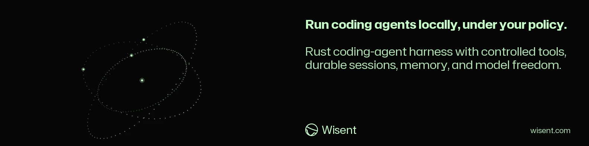

<!-- wisent-banner:start -->
<p align="center">
  
</p>
<!-- wisent-banner:end -->

<!-- wisent-readme-signals:start -->
[](https://github.com/wisent-ai/jeden) [](https://github.com/wisent-ai/jeden/issues) [](https://wisent.com) [](https://discord.gg/qRjpkthq54) [](https://www.linkedin.com/company/wisent-ai/) [](https://x.com/wisentai) [](https://calendly.com/lbartoszcze)
<!-- wisent-readme-signals:end -->

# Jeden

Jeden is a local coding-agent harness for interactive work, one-shot tasks and
contract-driven pursuit. It records sessions and tool decisions, asks for
approval before writes and commands unless the invocation grants them, and
keeps model access under the operator's control. The
[product documentation](https://jeden.wisent.com/docs) defines supported
behavior; the [CLI reference](https://jeden.wisent.com/docs/cli) lists commands,
refusals and examples.

## Model access and credentials

An explicit `JEDEN_MODEL_ENDPOINT` sends OpenAI-compatible catalog and chat
requests directly to that provider. A nonempty `JEDEN_MODEL_KEY` from the
process environment takes precedence; otherwise Jeden optionally reads its own
private token list at `~/.jeden/model-tokens.sqlite3`. `jeden token status`,
`list`, `add LABEL --endpoint URL` and `remove ID` manage that list; `add` reads
the secret from standard input, not a command argument. The selected key
advances per endpoint and a pre-output authentication, payment or rate-limit
refusal tries another untried key. Status and diagnostics reveal no secret.
[Jeden Desktop Settings](https://github.com/wisent-ai/jeden-desktop/blob/main/docs/model-credentials.md)
uses the same RPC operations on its selected host. See the
[token command](https://jeden.wisent.com/docs/cli/token) for refusal details.

Without a direct endpoint, Jeden uses Brama. Stado's service directory locates
its address unless the caller exports `BRAMA_URL`; the Brama signing credential
`WISENT_APP_AGENT_AUTH_SECRET` and distinct `BRAMA_TOKEN` come from the process
environment. Jeden does not fetch model secrets from Skarbiec; the launcher
that starts it hands them over:

```bash
stado credentials run \
  --env WISENT_APP_AGENT_AUTH_SECRET=role:jeden-agent-auth#agent_auth_secret \
  --env BRAMA_TOKEN=role:jeden-model-router#token \
  -- jeden run
```

Stado reads both fields into Jeden's environment only and then becomes Jeden;
a missing role or field is refused naming the variable before Jeden starts.
Brama retains its own account leases and routing; a direct provider requires
neither a Brama signature nor a gateway lease. `/setup` and `jeden doctor`
report the active route and observed catalog refusal.

Durable memory, pursuit request state and collab-relay rooms require an explicit
`JEDEN_DATABASE_URL`, with `JEDEN_DATABASE_CA_FILE` for a server database. A
SQLite file is local to its host; hosts share a server database when they use
the same one. Configuration, certificate, connection, migration and query
errors name the failed operation and cause. The database path does not consult
Skarbiec. See [sessions and memory](https://jeden.wisent.com/docs/sessions).

## Start and interfaces

```sh
npm run build:rust
jeden
jeden run "Read this project's package.json and explain its entry points."
```

A direct provider can be selected with `JEDEN_MODEL_ENDPOINT` and a key in
the environment or the optional private list. Brama instead needs its route
and process-owned credentials. Keep the signed sandbox helper beside the
executable on macOS; see the [signing contract](https://stado.wisent.com/docs/signing).

- `jeden run` handles a concrete task; `jeden pursue` integrates Pursuit's
  outcome contract and independent review with Jeden's model conversations.
- The interactive terminal has searchable management pickers and slash
  commands. `jeden todo list --json` reads retained work;
  `jeden todo continue --allow-write` continues with an explicit grant.
- `jeden rpc`, `jeden acp`, headless mode, the Rust SDK and the TypeScript SDK
  expose the same session protocol to automation and editors.
- Tools stay within the workspace jail and execution grants. File mutations
  return visual diffs; oversized results become referenced session artifacts.

Sessions and artifacts live under `~/.jeden/sessions/` unless
`JEDEN_SESSION_ROOT` is set. A task's completion state retains original
requests across new prompts, resets, forks and resumes. The native controller
checks acceptance evidence; a model's assertion alone is not completion.

## Verification and source contracts

`npm run test:contracts` builds the product and executes the real CLI and RPC
journeys with their declared dependencies, recording revision, binary digest,
commands, exit statuses and saved state. The direct-token qualification is
`node tests/model/tokens.mjs` with the real provider inputs documented by the
[token command](https://jeden.wisent.com/docs/cli/token). A failed or blocked
model journey is not a pass. Probierz is optional.

- [Configuration and context](docs/configuration.md)
- [Release automation](docs/release.md)
- [Roadmap registry](docs/roadmap.md)
- [Extension reload](docs/extension-reload.md)
- [Tools and action protocol](https://jeden.wisent.com/docs/tools)
- [Sessions and memory](https://jeden.wisent.com/docs/sessions)

Jeden is a command-line package, not a fleet service. Stado builds, signs and
publishes the declared artifacts; consumers install the executable and its
matching sandbox helper. The documentation site renders its pages from the
source on each push to `main`, so a documentation change is delivered with
its source revision. Non-sensitive support reports belong in the public
[issue tracker](https://github.com/wisent-ai/jeden/issues); vulnerabilities
belong in GitHub Security Advisories.
